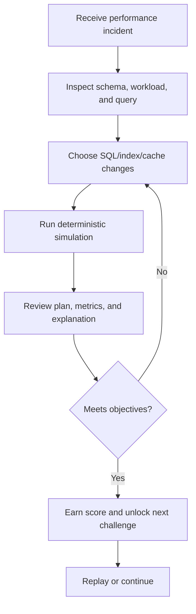
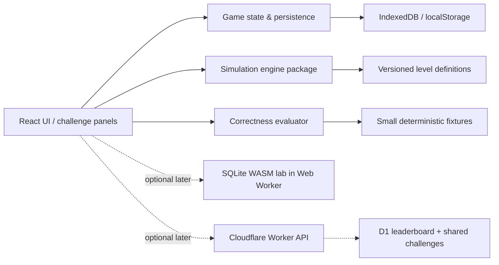

# QueryCraft

> **Optimize the query. Scale the system. Beat the bottleneck.**
>
> An open-source, browser-based database performance puzzle game where players learn SQL query planning, indexing, caching, partitioning, and scaling through interactive challenges and explainable simulations.

**Document type:** Product requirements + technical design + implementation roadmap  
**Status:** Proposed / pre-development  
**Version:** 0.1.0 (planning)  
**Initial release:** Web/PWA, desktop-first  
**Primary audience:** Beginner-to-intermediate backend developers, CS students, SQL learners, interview candidates  
**Initial database dialect:** PostgreSQL-inspired (educational subset; not a claim of exact PostgreSQL behavior)  
**Licensing proposal:** MIT for application code; separately document any third-party assets and sample datasets

---

## 1. Executive summary

QueryCraft is a **puzzle game, not another SQL tutorial or benchmark**. Players enter a stylized database operations room, receive a concrete performance problem, inspect a table/query/workload, and choose SQL or infrastructure changes to meet a measurable target. Each decision changes estimated query latency, bytes scanned, memory usage, write amplification, and resource cost. An explanation panel connects the outcome to the underlying database concepts.

The product has two carefully separated modes:

1. **Simulation mode (core game):** A deterministic, lightweight model estimates behavior for very large _virtual_ datasets without storing millions or billions of actual rows. It uses declared workload characteristics and documented assumptions to calculate consistent comparative outcomes.
2. **Real SQL lab (optional, later):** Executes supported sample SQL against a small, isolated, local SQLite WASM database to demonstrate real query correctness and query plans. It must never be presented as a billion-row benchmark or a PostgreSQL execution environment.

The MVP focuses on **index selection and query shape** and expands to covering indexes, pagination, joins, caching, partitioning, and read/write trade-offs.

### Product promise

- Make database performance concepts feel like solvable puzzles.
- Show **why** an optimization succeeds or fails.
- Make advanced topics accessible without expensive infrastructure.
- Help players transfer concepts to real-world `EXPLAIN`, profiling, and workload measurement.
- Make the game instantly playable in the browser, with no login required.

### One-sentence pitch

> **QueryCraft is a database optimization game where every query is a puzzle, every index is a trade-off, and one billion rows are only the beginning.**

---

## 2. Problem and opportunity

### The problem

Many developers know how to write `SELECT` statements but struggle to explain:

- Why a query slows down as a table grows.
- When a full scan is reasonable and when an index helps.
- Why column order matters in composite B-tree indexes.
- Why `LIMIT` does not automatically make deep-offset pagination cheap.
- When a covering/index-only approach helps, and why it is not guaranteed.
- How selectivity, skew, and query patterns influence plans.
- How fast reads can create expensive writes and storage overhead.
- What caching solves—and what invalidation complicates.
- Why a simulation's predicted speedup is not an actual production benchmark.

Documentation, lectures, and conventional coding exercises often isolate a concept without the system-level consequence. QueryCraft makes the decision and its trade-offs visible.

### Target users

| Persona                    | Need                                | Representative success                           |
| -------------------------- | ----------------------------------- | ------------------------------------------------ |
| Student learning databases | Build intuition through interaction | Explains scans vs indexes correctly              |
| Junior backend engineer    | Learn practical optimization        | Selects an appropriate index for a workload      |
| Mid-level engineer         | Explore realistic trade-offs        | Balances read latency and insert overhead        |
| Interview candidate        | Practice reasoning aloud            | Justifies composite index and pagination choices |
| Instructor/content creator | Demonstrate concepts                | Shares a reproducible challenge with students    |

### Positioning

Unlike a general SQL practice platform, QueryCraft focuses on **performance engineering**, visual causal feedback, and progression. It does not replace vendor documentation or real benchmarking.

---

## 3. Goals, non-goals, and success metrics

### Product goals

1. A new player can finish the tutorial in under 8 minutes without creating an account.
2. A player can explain the difference between a sequential scan and an index-assisted lookup after the first world.
3. Every scored level has at least one reproducible solution with a documented expected outcome.
4. Players see the **latency / work / storage / writes** trade-off, not just a green checkmark.
5. Levels support replay, experimentation, and sharing results without exposing personal data.
6. The app is fast, accessible, keyboard usable, and deployable at low cost.

### Non-goals for MVP

- Running a literal billion-row database in the browser or on a server.
- Emulating PostgreSQL internals perfectly.
- Offering a production SQL query optimizer or database advisor.
- Accepting arbitrary SQL or URLs on a server.
- A multiplayer server or real-money features.
- Full support for all database vendors and their query planners.
- LLM-generated authoritative performance scores.

### Suggested product metrics

| Metric                                   | Target / interpretation                                    |
| ---------------------------------------- | ---------------------------------------------------------- |
| First-level completion rate              | Baseline after launch; improve through usability testing   |
| Tutorial time                            | Target < 8 minutes, measured in voluntary testing          |
| Level replay rate                        | Measures whether experiments are inviting                  |
| Explanation-open rate                    | Indicates whether players engage with learning content     |
| Completion rate by level                 | Identifies confusing or poorly balanced puzzles            |
| Core bundle size and interaction latency | Track against an explicit performance budget               |
| Determinism                              | Same level + model version + choices = same score          |
| Accessibility                            | WCAG 2.2 AA design target, manual and automated validation |

Avoid inventing a retention number before acquiring actual user data.

---

## 4. Game premise and experience

### Theme

The player is a new **Query Engineer** tasked with stabilizing a fictional service called **DataGrid**. Its user population and workloads grow each chapter: from a tiny customer directory to a huge event stream. A system monitor reports incidents; players fix them using a constrained toolset.

**Tone:** Minimalist, technical, playful—not childish. Think CLI/IDE aesthetics, crisp cards, subtle animations, optional sound, and easy-to-read charts.

### Core loop



### Main gameplay actions

- Inspect a schema, row count, key distribution, and sample records.
- Read current query and workload frequency.
- Add/drop indexes from approved options; later compose an index from supported columns.
- Edit or choose a query rewrite (within a safe, supported subset).
- Toggle a cache strategy or select a partitioning key in advanced levels.
- Run simulation; inspect estimated plans and metric changes.
- Compare candidate solutions; reset and retry.
- Submit a working solution and view an explanation.

### Player feedback

After every run, show:

- **Objective:** e.g., estimated p95 latency ≤ 50 ms for a declared synthetic workload.
- **Before / after:** estimated query latency, rows examined, estimated logical page reads, index size, write penalty.
- **Plan visualization:** scan → filter → sort → limit, or index lookup → fetch.
- **Why it changed:** short causal explanation and relevant conditions.
- **Warnings:** the metric is a **model estimate**, not measured PostgreSQL performance.

Never promise one universal winner: solutions depend on workload shape and assumptions.

---

## 5. Visual and UX specification

### Visual direction

- Dark-first UI, with a fully supported light theme.
- Minimal monochrome surfaces, one distinctive accent for active controls.
- Readable monospace for SQL/metrics, sans-serif for learning content.
- Grid and dot motifs used sparingly; avoid relying on color alone.
- Short, informative animation only when it explains an operation.
- Respect reduced-motion settings.

### Primary screens

1. **Landing:** one-line value proposition, animated-but-skippable sample plan, Play button, no-login promise.
2. **World map:** numbered worlds, unlocked puzzles, progress, topic badges.
3. **Challenge:** incident brief, SQL/schema panel, allowed tools, run button, results/plan pane, hint controls.
4. **Debrief:** score, solved constraints, performance delta, what was learned, share card.
5. **Sandbox:** free experimentation with clearly indicated model assumptions and no score.
6. **Settings:** accessibility, theme, sound, progress export/import, privacy controls.
7. **About/model:** transparent explanation of simulation vs execution and version information.

### Proposed desktop challenge layout

```text
┌──────────────────────────────────────────────────────────────────────────┐
│ QUERYCRAFT         WORLD 2 / LEVEL 04      ⭐⭐☆          Settings         │
├──────────────────────────┬─────────────────────────┬─────────────────────┤
│ INCIDENT + OBJECTIVES    │ SQL / SCHEMA            │ PLAN + METRICS      │
│ Slow user lookup         │ SELECT ...              │ Seq Scan            │
│ Rows: 10,000,000         │                         │ Filter              │
│ Target: ≤ 50 ms          │ Allowed index actions   │ Sort                │
│ Write budget: ≤ 10%      │ [Create index]          │ Est. latency        │
│                          │ [Rewrite query]         │ Rows examined       │
│ Hints                    │ [Run simulation]        │ Storage / writes    │
├──────────────────────────┴─────────────────────────┴─────────────────────┤
│ EXPLANATION  |  COMPARE RUNS  |  RESET  |  SUBMIT SOLUTION                │
└──────────────────────────────────────────────────────────────────────────┘
```

On mobile, replace columns with labeled tabs and keep the primary Run action accessible.

### Accessibility

- Semantic headings, labels, focus order, visible focus indicators.
- Fully keyboard-operable actions; no drag-and-drop-only puzzles.
- Colors accompanied by labels, icons, or text.
- Chart and plan text equivalents.
- Pause, disable, or reduce nonessential motion.
- Optional onboarding explanations; no forced timed rounds.
- SQL error messages identify a location and actionable reason where possible.

---

## 6. Learning design and level progression

Each level has: **concept, prior knowledge, scenario, permitted actions, constraints, success condition, common misconception, hints, explanation, and reference behavior**.

### World 0 — The first query (tutorial, ~3 levels)

1. **Hello, Table:** find a user by ID; introduce rows and filtering.
2. **The Long Scan:** compare index-assisted and full scan behavior at different sizes.
3. **Too Many Rows:** understand selectivity and query cost.

### World 1 — Index fundamentals (~5 levels)

4. **Needle in a Million:** add an index on a selective lookup key.
5. **Name Collision:** recognize non-unique `name` lookup and low selectivity.
6. **The Price of an Index:** optimize reads under an insertion-cost budget.
7. **Range Runner:** understand B-tree range access.
8. **Index Overload:** remove redundant/unhelpful indexes to meet storage constraints.

### World 2 — Query shape (~5 levels)

9. **Only the Columns You Need:** compare wide vs narrow projections.
10. **Sorting Bottleneck:** explore index ordering under explicit assumptions.
11. **Two-Column Lock:** choose composite index column order for equality + range predicates.
12. **Cover Me:** learn what covering/index-only access can and cannot guarantee.
13. **The Misleading Limit:** see why LIMIT is not a universal shortcut.

### World 3 — Pagination and joins (~4 levels)

14. **Page 10,000:** OFFSET vs keyset pagination for a supported order.
15. **Join Explosion:** avoid expensive nested-loop-like behavior with appropriate indexes.
16. **Filter Before or After?:** study predicate pushdown conceptually.
17. **Hot User, Cold Data:** model skewed access patterns.

### World 4 — Cache and scale (~4 levels)

18. **Repeat Request:** choose a cache when reads repeat and data changes slowly.
19. **Stale Data:** pick TTL/invalidation under a freshness requirement.
20. **Shard or Partition?:** choose partitions for a time-range workload and examine pruning constraints.
21. **Read vs Write:** optimize an entire workload, not one isolated query.

### World 5 — Boss levels (post-MVP)

22. **The Flash Sale:** read bursts, hot keys, freshness concerns.
23. **A Billion Events:** choose retention, partitioning, indexing, and pagination.
24. **Production Incident:** diagnose conflicting metrics with limited actions.

**Release strategy:** Build a **vertical slice of 6 polished levels** first (tutorial + fundamental indexes + one workload trade-off). Additional levels are content, not prerequisites for validating the engine.

### Example level design

**Level:** `w1-l1-needle-in-a-million`  
**Concept:** An index can reduce work for a highly selective equality predicate.

```sql
CREATE TABLE users (
  id BIGINT PRIMARY KEY,
  email TEXT NOT NULL,
  name TEXT NOT NULL,
  created_at TIMESTAMPTZ NOT NULL
);

SELECT id, email FROM users WHERE email = 'sample@example.test';
```

**Declared virtual workload:** 1,000,000 rows; `email` unique; 95% reads / 5% inserts; cold-cache baseline; an educational B-tree cost model. The primary-key index already exists but cannot directly satisfy the email predicate.

**Player tools:** Add an index on `email`, add one on `name`, or leave unchanged.

**Target:** Estimated latency reduction ≥ 70% **and** storage below a declared budget. Targets are tuning parameters for the simulation and must be checked with actual calibrated level fixture outputs before publishing.

**Expected strategy:** Index `email`, explaining why uniqueness/selectivity makes it useful, while observing the storage/write cost.

**Counterexample / extension:** A tiny table, or a predicate returning most of the table, may favor a scan.

**Hint ladder:**

1. “Which column does the WHERE clause use?”
2. “How many rows are expected to match?”
3. “Try an index on `email`, then compare rows examined.”

**Debrief:** Explain how index-assisted retrieval reduces scanning in this modeled workload; contrast with a real DB planner that considers statistics, cache, row width, and table size.

---

## 7. Gameplay rules and scoring

### Objectives are constraints, not just fastest-time wins

A challenge may require simultaneously:

- `estimatedP95Ms <= targetP95Ms`
- `indexStorageMb <= storageBudgetMb`
- `writeOverheadPct <= writeBudgetPct`
- `resultCorrectness === true`
- `freshnessLagMs <= freshnessBudgetMs` (advanced levels)

A run that fails correctness **cannot pass**, regardless of performance.

### Score proposal

- **1 star:** Correct result + mandatory objectives met.
- **2 stars:** Meets objectives with a reasonable resource budget.
- **3 stars:** Meets a documented efficiency target, including write/storage trade-offs.

For transparent optional ranking, use a bounded, normalized score rather than an arbitrary “milliseconds saved” total:

```text
latencyScore = clamp((baselineP95 - candidateP95) / max(baselineP95, epsilon), 0, 1)
storagePenalty = clamp(candidateIndexStorage / max(storageBudget, epsilon), 0, 1)
writePenalty = clamp(candidateWriteOverhead / max(writeBudget, epsilon), 0, 1)

score = round(100 * (0.7 * latencyScore
                    + 0.15 * (1 - storagePenalty)
                    + 0.15 * (1 - writePenalty)))
```

**Important:** Formula is illustrative and needs playtesting. Hard constraints gate success; score is not a substitute for them. Compare solutions only under the **same level and simulation model version**. Hints should not prevent completion; optionally distinguish an unassisted badge.

### Anti-frustration rules

- Unlimited retries; no energy/lives system.
- A reset restores the level state, not global progress.
- Explain why a failed run failed, including the first violated requirement.
- Show a suggested path only after player opts into hints.
- Encourage exploration; no punishment for mistakes.

---

## 8. Simulation engine design

### 8.1 Design principle

Use a **deterministic, explainable cost model**. A modeled billion-row table is a number and distribution metadata, **not** one billion generated objects. Performance should be described as **estimated**. Never label its results “measured execution time” unless an actual database execution produced that value.

### 8.2 Three distinct data layers

1. **Scenario metadata:** row count, columns, cardinality, selectivity distributions, row sizes, update/write rates, cache state, and candidate indexes.
2. **Query representation:** structured AST/DSL with a limited set of predicates, projections, sorting, and joins.
3. **Cost model:** predicts logical operations and synthetic latency from documented assumptions; returns a chosen candidate plan and explanation trace.

### 8.3 Core supported query subset for MVP

- Single-table `SELECT`.
- `WHERE` equality, range, and a limited `AND` composition.
- `ORDER BY` on supported columns, `ASC`/`DESC`.
- `LIMIT` and `OFFSET` (later milestone).
- `CREATE INDEX` / `DROP INDEX` as game actions, not arbitrary remote DDL.
- Fixed schema and workload supplied by each level.

Explicitly **out of MVP scope**: general joins, subqueries, CTEs, arbitrary functions, regex/LIKE planning, optimizer hints, transactions, locks, multi-column statistics, advanced index types. Support these later only with model semantics and tests.

### 8.4 Table and index model

Proposed TypeScript domain objects (illustrative):

```ts
type ColumnDistribution =
  | { kind: "unique"; distinctCount: number }
  | { kind: "uniform"; distinctCount: number }
  | {
      kind: "skewed";
      distinctCount: number;
      hotKeys: Array<{ value: string; fraction: number }>;
    };

type Column = {
  name: string;
  type: "bigint" | "text" | "timestamp" | "boolean";
  averageBytes: number;
  distribution: ColumnDistribution;
};

type TableModel = {
  name: string;
  rowCount: number; // virtual, never materialized
  avgRowBytes: number;
  columns: Column[];
  indexes: IndexModel[];
  estimatedRowsPerPage: number;
};

type IndexModel = {
  id: string;
  name: string;
  kind: "btree";
  columns: Array<{ name: string; direction: "asc" | "desc" }>;
  includeColumns?: string[]; // optional, post-MVP
  unique?: boolean;
};

type WorkloadModel = {
  readsPerSecond: number;
  insertsPerSecond: number;
  updatesPerSecond: number;
  warmCacheFraction: number;
};
```

Require distributions to be valid (fractions sum appropriately; distinctCount ≤ rowCount when rowCount > 0; no negative widths/rates). Store index page estimates and model constants separately so level authors can reproduce outcomes.

### 8.5 Plan candidates

The MVP compares a limited, explicit set of alternatives:

- Full table scan + filter.
- Single-column B-tree index lookup + estimated row fetches.
- Index range scan + estimated row fetches.
- Index scan that can satisfy sorting if query/order constraints allow.
- Filter + explicit sort where needed.

Post-MVP: composite-prefix matching, covering/index-only cases, keyset access, nested-loop/hash-join approximations, partition pruning, cache hit/miss and invalidation.

### 8.6 Explainable costs

Suggested modeled work units:

- `rowsExamined`
- `sequentialPagesRead`
- `randomPagesRead`
- `indexPagesTraversed`
- `rowsSorted`
- `estimatedCpuOperations`
- `indexStorageBytes`
- `estimatedWriteAmplification`

Illustrative estimation model:

```text
pageCount ≈ ceil(rowCount * avgRowBytes / pageBytes)
selectivity ≈ estimatePredicateSelectivity(columnDistribution, predicate)
matchingRows ≈ max(0, round(rowCount * selectivity))

sequentialScanCost = pageCount * sequentialPageUnit
                   + rowCount * predicateCpuUnit

btreeLookupCost = estimatedTreeHeight * randomPageUnit
                + estimatedMatchingDataPages * randomPageUnit
                + matchingRows * tupleCpuUnit

sortCost ≈ rowsToSort * log2(max(rowsToSort, 2)) * comparisonUnit

estimatedWorkCost = scanOrIndexCost + sortCost + otherSupportedOperations
estimatedLatencyMs = calibratedBaseMs + estimatedWorkCost * levelScaleFactor
```

These equations are **teaching approximations**. Do not imply linear latency conversion across real hardware. B-tree height depends on estimated entry width/fanout. Random data page reads may have overlap and different warm-cache costs. `estimatedMatchingDataPages` requires a row-location/clustering assumption, not a naïve one-page-per-row claim. Provide model explanations for each assumption.

### 8.7 Plan selection

```ts
function simulate(input: SimulationInput): SimulationResult {
  const query = validateAndNormalizeQuery(input.query);
  const candidates = enumerateSupportedPlans(input.table, query);
  const evaluations = candidates.map((plan) => estimatePlan(plan, input));
  const selected = stableMinBy(evaluations, (x) => x.totalEstimatedCost);
  return {
    modelVersion: SIMULATION_MODEL_VERSION,
    selectedPlan: selected.plan,
    metrics: selected.metrics,
    alternatives: evaluations,
    explanationTrace: selected.explanations,
    warnings: ["Synthetic estimates; not measured database execution."],
  };
}
```

Use a defined tie-breaker and deterministic rounding. Handle zero-row tables, very large cardinalities, and invalid selectivity without NaN/Infinity. Clamp or reject values that exceed chosen safe numeric bounds.

### 8.8 Workload and p95 labeling

A single-query average cost estimate **is not a p95 latency**. For MVP either:

- Use **`estimatedCostUnits`** or **`estimatedLatencyMs`** without any p95 assertion; **recommended**, or
- Build a deterministic distribution model with defined request classes, cache-hit randomness/quantiles, and arrival rates before showing `estimatedP95Ms`.

The sample challenges and score thresholds in this document use “estimated p95” as a desired future presentation, **not an MVP capability**. In MVP UI and fixtures, substitute **estimated latency** until the quantile model is implemented and tested.

### 8.9 Realism, calibration, and limits

- Test qualitative ranking against tiny real SQLite workloads where feasible, but do not present cross-engine measurements as PostgreSQL truth.
- Publish a `/docs/simulation-model.md` document with formulas, constants, limitations, and model version.
- Include counterexamples: low-selectivity index, small table, cold vs warm cache, read-heavy vs write-heavy workloads.
- Label every displayed metric with provenance: `estimated`, `real (local SQLite)`, or `user-provided`.
- Never claim a chosen action will improve a user's production workload without actual profiling.

---

## 9. Correctness engine

A performance puzzle must not reward a query that returns the wrong rows.

### MVP approach

For each level, use a **structured query builder** or a small, explicitly supported parser; the player can choose actions/predicates in a constrained interface. A canonical query representation (AST) is evaluated against a **small synthetic fixture** to check equality of results against a reference query, including required column output and ordering where applicable.

- Use isolated, deterministic sample data with a fixed seed.
- Compare normalized result sets when order is irrelevant; compare order when required.
- Check duplicates and null behavior explicitly.
- Validate `LIMIT`/`OFFSET` semantics when they enter scope.
- Performance and correctness are separate result objects.
- Add property-based tests across generated small fixtures for semantic edge cases.

**Never** infer semantic equivalence purely from string similarity or an LLM's opinion.

### SQL editing transition

For v0.1 prefer a **read-only SQL display + permitted actions**. A writable SQL editor may be introduced when the supported grammar and equivalence checker are reliable. Show a precise unsupported-syntax message rather than pretending an arbitrary query ran.

---

## 10. Architecture

### Core principle: local-first, static-first

Ship a playable SPA/PWA hosted as static assets. The deterministic simulation runs in the browser (optionally in a Web Worker). No paid API or backend is required for game progress.



### Suggested stack

| Concern         | Recommendation                               | Rationale                                               |
| --------------- | -------------------------------------------- | ------------------------------------------------------- |
| App shell       | Vite + React + TypeScript                    | Fast iteration and interactive game UI                  |
| Styles          | CSS variables + accessible primitives        | Custom lightweight design, minimal dependency footprint |
| Code viewer     | Shiki (static/read-only) initially           | Highlight SQL without heavy editable infrastructure     |
| Editor (later)  | Monaco or CodeMirror, lazy-loaded            | SQL editing after grammar is supported                  |
| Domain models   | TypeScript + Zod-like runtime validation     | Safe user/level input boundaries                        |
| State           | Local React state + small persistence module | Avoid unnecessary global complexity                     |
| Persistence     | IndexedDB, fallback to localStorage          | Offline progress and saved attempts                     |
| Charts          | Lightweight SVG-based custom charts          | Accessibility and fine-grained teaching labels          |
| Simulation      | Pure TS package, Web Worker if needed        | Reusable, testable, deterministic                       |
| SQL lab (later) | SQLite WASM in isolated Web Worker           | Actual local SQL execution on small fixtures            |
| Hosting         | Cloudflare Pages or other static hosting     | Low cost; straightforward publishing                    |
| CI              | GitHub Actions                               | Lint, type-check, tests, build, deploy                  |
| Testing         | Vitest, Testing Library, Playwright          | Unit, integration, and browser flows                    |
| Repo tooling    | Bun workspaces or pnpm workspaces            | Optional; choose one and pin toolchain                  |

**Important:** Exact dependency versions should be pinned from current registries at implementation time, not guessed in this spec.

### Monorepo proposal

```text
querycraft/
├── apps/
│   └── web/
│       ├── public/
│       ├── src/
│       │   ├── app/
│       │   ├── components/
│       │   ├── features/
│       │   │   ├── worlds/
│       │   │   ├── challenge/
│       │   │   ├── simulation/
│       │   │   ├── debrief/
│       │   │   └── sandbox/
│       │   ├── hooks/
│       │   ├── styles/
│       │   └── main.tsx
│       └── index.html
├── packages/
│   ├── engine/
│   │   ├── src/
│   │   │   ├── domain/
│   │   │   ├── query/
│   │   │   ├── plans/
│   │   │   ├── costs/
│   │   │   ├── correctness/
│   │   │   └── index.ts
│   │   └── tests/
│   ├── levels/
│   │   ├── src/
│   │   └── fixtures/
│   └── ui/                # optional after UI stabilizes
├── docs/
│   ├── product/
│   ├── architecture/
│   ├── simulation-model.md
│   ├── level-authoring.md
│   └── accessibility.md
├── scripts/
├── .github/workflows/
├── CONTRIBUTING.md
├── LICENSE
├── README.md
└── package.json
```

Keep the engine free of React, the DOM, storage APIs, and network requests, so it can later become an independent npm package such as `@querycraft/engine` if the package name is available.

---

## 11. Data contracts and example level

```ts
type QueryPredicate =
  | { op: "eq"; column: string; value: string | number | null }
  | { op: "range"; column: string; gte?: number; lt?: number };

type QuerySpec = {
  table: string;
  select: string[];
  predicates: QueryPredicate[];
  orderBy?: Array<{ column: string; direction: "asc" | "desc" }>;
  limit?: number;
  offset?: number;
};

type Objective =
  | { metric: "estimatedLatencyMs"; comparator: "<="; value: number }
  | { metric: "indexStorageMb"; comparator: "<="; value: number }
  | { metric: "writeOverheadPct"; comparator: "<="; value: number };

type LevelDefinition = {
  schemaVersion: 1;
  id: string;
  worldId: string;
  title: string;
  conceptTags: string[];
  description: string;
  table: TableModel;
  referenceQuery: QuerySpec;
  allowedActions: Array<"add-index" | "drop-index" | "change-query">;
  objectives: Objective[];
  hints: string[];
  lesson: string;
  fixtureId: string;
  modelVersion: string;
};

type SavedProgress = {
  schemaVersion: 1;
  completedLevelIds: string[];
  bestScoresByLevel: Record<string, { score: number; modelVersion: string }>;
  settings: { theme: "light" | "dark" | "system"; reduceMotion: boolean };
};
```

### Authoring flow

1. Write a level definition and a small correctness fixture.
2. Document the intended concept and at least one failure mode.
3. Define the allowed changes and constraints.
4. Run the level test harness to obtain **actual engine output**.
5. Tune thresholds from measured simulation outputs (not guessed target numbers).
6. Add a golden fixture for expected explanation and score.
7. Have another developer solve it without reading the intended answer.

### Versioning

- `schemaVersion`: format of level/progress documents.
- `modelVersion`: cost-model semantics and constants.
- `gameVersion`: app release tag.
- Persist score with model version; when a model changes, either migrate/recompute or label older best scores as historical. Never silently compare incomparable results.

---

## 12. Sample run and plan visualization

```text
LEVEL: Needle in a Million
Scenario: users table; 1,000,000 virtual rows; email is unique

BASELINE (estimated, synthetic)
  Plan: Full Scan → Filter
  Rows examined: ~1,000,000
  Storage: no new index

PLAYER ACTION
  CREATE INDEX idx_users_email ON users(email);

CANDIDATE (estimated, synthetic)
  Plan: B-tree Index Lookup → Row Fetch
  Rows examined: approximately 1 matching row
  Storage: increases
  Insert overhead: increases

EXPLANATION
  Email is highly selective. The modeled index narrows candidate rows
  drastically, but takes disk space and requires upkeep on writes.

NOTICE
  These are logical simulation outputs, not observed PostgreSQL timings.
```

Do **not** bake made-up millisecond numbers into UI examples; display numbers produced by the engine with the scenario's stated assumptions.

---

## 13. Persistence, privacy, security, and fairness

### MVP privacy

- Anonymous by default; no account needed.
- Progress stays local unless the player explicitly exports it.
- No automatic uploads of SQL text, progress, or identifiers.
- No third-party analytics by default; disclose any analytics if added.
- Provide reset/export/import progress controls.
- Validate imported files and size-limit them.

### Security model

- No server-side execution of player-submitted SQL.
- Render SQL/text as plain text; do not inject it as HTML.
- Treat shared level definitions as untrusted data; validate sizes and schema.
- Keep optional SQLite WASM DB isolated in a worker; bound computation and database sizes.
- Sanitize share metadata; encode URLs; do not interpret arbitrary script content.
- Add security headers and a content-security policy consistent with chosen app assets.
- Rate-limit future hosted share/leaderboard APIs.
- If public leaderboards are added, **never trust a browser-reported score**: replay signed/validated action submissions using the authoritative server engine/model, or explicitly label leaderboards as casual/non-competitive.
- Do not require third-party AI model access or API keys in the browser.

### Accessibility and ethical design

- Avoid addictive streak pressure, punitive countdowns, and opaque rankings.
- Reward reasoning and experimentation, not repeated compulsive checking.
- Avoid collecting more data than necessary.
- Content must not suggest production deployment of tuning tips without benchmarking.

---

## 14. Optional AI features (not required for MVP)

AI can improve teaching but must **not** determine scoring or query correctness.

Potential opt-in features:

- **Explain my plan:** rephrase a deterministic plan trace for different knowledge levels.
- **Socratic tutor:** ask targeted questions before showing hints.
- **Level author assistant:** draft a level for instructor review and engine validation.
- **Review my reasoning:** critique a player's written explanation, clearly labeled as AI feedback.

Safety/quality rules: ground any explanation in actual engine traces, do not send private SQL without explicit opt-in, rate-limit API usage, do not embed provider keys in client code, and offer a non-AI fallback for every essential learning feature.

---

## 15. Development roadmap

### Phase 0 — Foundation (1–2 days)

- [ ] Initialize repository, license, code of conduct, contributing guide.
- [ ] Choose and pin runtime/package manager.
- [ ] Set up Vite, React, TypeScript, formatting, linting, tests, and CI.
- [ ] Establish design tokens and basic responsive layout.
- [ ] Add project documentation and a simulation limitations page.

**Exit condition:** Clean install, tests, and deployment build work on a fresh machine.

### Phase 1 — Simulation vertical slice (3–5 days)

- [ ] Define normalized table, query, index, and workload schemas.
- [ ] Implement full-scan and B-tree equality-lookup candidates.
- [ ] Implement deterministic costs and plan selection.
- [ ] Implement read/write/storage metrics, assumption tracing, and explanations.
- [ ] Create at least 6 edge-case/golden engine tests.
- [ ] Create the first sample level and baseline vs optimized scenarios.

**Exit condition:** Same inputs return same metrics; example index choice changes modeled work as documented.

### Phase 2 — Playable core (3–5 days)

- [ ] Create challenge layout, schema viewer, SQL preview, index controls.
- [ ] Add Run / Compare / Reset / Submit flow.
- [ ] Implement objective validation and basic star scoring.
- [ ] Add level unlocking and local persistence.
- [ ] Create onboarding and hint ladder.
- [ ] Add keyboard and responsive testing.

**Exit condition:** A new player can complete a level without developer tools or assistance.

### Phase 3 — Content and polish (3–5 days)

- [ ] Author 6 launch levels; each includes a correct reference fixture.
- [ ] Add deliberate counterexample and read/write trade-off challenges.
- [ ] Add plan diagram, metric deltas, and debrief screen.
- [ ] Add theme/reduced-motion and progress export/import.
- [ ] Implement automated browser-based journey tests.
- [ ] Conduct a small user playtest and revise unclear explanations.

**Exit condition:** Complete vertical slice with stable, explainable scoring and no blocking usability issues.

### Phase 4 — Public launch (1–2 days)

- [ ] Deploy to static hosting with custom domain if available.
- [ ] Set up production caching and security headers.
- [ ] Publish README with screenshots, learning outcomes, privacy note.
- [ ] Add issue templates and a clear roadmap.
- [ ] Create a short gameplay GIF/demo (original assets only).
- [ ] Announce on GitHub and relevant developer communities.

**Exit condition:** Public playable link + tagged release + reproducible builds.

**Estimate:** Roughly **2–4 focused weeks** for a polished 6-level MVP for one developer using AI-assisted tooling. This is a planning estimate, not a delivery commitment. Larger worlds, writable SQL, AI features, and online leaderboards are separate follow-up releases.

---

## 16. Release scope

### v0.1 — Playable MVP (must-have)

- Six curated levels.
- Full scan vs indexed equality/range access.
- Supported simple filters and fixed queries.
- Indexed/scan plan comparisons.
- Estimated latency/work/storage/write metrics.
- Scoring with hard objectives and educational debrief.
- Local progress and reset.
- Accessible responsive interface.
- Offline-capable core after initial load (where browser permits).
- No login and no backend dependency.

### v0.2 — Query engineer

- Composite indexes and index-order effects.
- ORDER BY and basic sorting models.
- Selectivity and skew challenge content.
- Expanded metric explanations and sandbox mode.

### v0.3 — Deep query puzzles

- Pagination (OFFSET/keyset) and correct ordering.
- Covering/index-only model with explicit assumptions.
- More level-authoring tooling and fixture tests.

### v0.4 — Systems engineer

- Cache scenarios and freshness constraints.
- Partition-pruning teaching model.
- Whole-workload optimization and workload-weighted scoring.

### v1.0 — Community-ready

- Stable public engine API and level authoring specification.
- Curated community levels; validated import/share format.
- Optional small real SQLite WASM lab.
- Improved tutorial and verified cross-browser accessibility.

**Maybe later:** optional hosted accounts, leaderboards, user-made campaigns, AI tutor, classroom playlists. These are not launch blockers.

---

## 17. Testing and quality assurance

### Unit tests

- Predicate selectivity: unique, uniform, skewed, zero rows, missing/null cases.
- Index applicability: wrong column, equality lookup, range, unsupported operator.
- Scan/index choice: index loses when selectivity is low or table is tiny.
- Cost calculations: bounded, no NaN/Infinity, monotonicity where assumptions require it.
- Tie-breaking and deterministic rounding.
- Score boundaries and impossible objectives.
- Schema validation and corrupt progress recovery.

### Integration tests

- Level definition loads and matches supported engine model version.
- Correctness checker rejects result-changing rewrites.
- Every published level is solvable with permitted actions.
- All thresholds are achievable by at least one golden solution.
- Scoring is stable given the same model version.
- Import/export round trip preserves valid progress.

### End-to-end tests

- Fresh visitor → tutorial → solve → debrief → unlock → reload.
- Retry a failed solution → see feedback → successful retry.
- Keyboard-only player completes the first level.
- Mobile viewport does not obscure Run or Submit.
- Offline reload and progress persistence (on supported browsers).
- Reduced-motion setting is respected.

### Quality gates

- Typecheck, lint, unit tests, and production build on every PR.
- Critical browser flow in CI.
- No uncaught runtime exceptions from valid level data.
- Auditable simulation assumptions and deterministic golden fixtures.
- Core accessible with JavaScript enabled; no sign-in or payment needed.

---

## 18. Definition of done for a level

A level is **done** only when:

- [ ] Concept and prerequisite are declared.
- [ ] Query/table model matches supported grammar.
- [ ] At least one valid, correct, achievable solution exists.
- [ ] A tempting but incorrect/inefficient option is explained.
- [ ] Metrics and objectives come from actual engine output.
- [ ] At least one golden test protects expected behavior.
- [ ] Hints progress from conceptual to specific.
- [ ] Debrief explains causation and real-world caveats.
- [ ] No purely visual or timing-based action is mandatory.
- [ ] Mobile and keyboard behavior are reviewed.

---

## 19. Example API for a publishable engine package

The engine should be usable independently from the game UI.

```ts
import { simulate, evaluateObjectives } from "@querycraft/engine";

const result = simulate({
  modelVersion: "0.1",
  table: level.table,
  query: level.referenceQuery,
  workload: level.workload,
  proposedIndexes: playerIndexes,
});

const evaluation = evaluateObjectives(result, level.objectives);

console.log(result.selectedPlan);
console.log(result.metrics.estimatedLatencyMs);
console.log(evaluation.passed);
```

This is a **proposed** package/API, not an existing published dependency. Final arguments should be reconciled with validated domain types. If released, provide generated declarations, ESM exports, examples, and semantic versioning.

---

## 20. Documentation deliverables

Before launch, create:

- `README.md` — pitch, features, screenshots, quick start, tech stack, status.
- `docs/simulation-model.md` — all formulas, assumptions, and limitations.
- `docs/level-authoring.md` — schemas, examples, validation and golden test workflow.
- `docs/architecture/overview.md` — boundaries between UI/engine/content/persistence.
- `docs/accessibility.md` — keyboard, screen-reader, and contrast testing guidance.
- `CONTRIBUTING.md` — local setup, PR expectations, quality checks.
- `SECURITY.md` — vulnerability reporting and untrusted-content handling.
- `CHANGELOG.md` — changes including simulation model revisions.
- `LICENSE` — project license.

### Suggested README opening

> **QueryCraft** is an open-source, interactive puzzle game for learning database performance. Design indexes, reshape queries, and balance latency against storage and write cost—from a thousand rows to a billion _virtual_ records. Every result includes an explainable plan and simulated metrics. Play free, no account required.

---

## 21. Risks and mitigations

| Risk                                                | Impact                                           | Mitigation                                                              |
| --------------------------------------------------- | ------------------------------------------------ | ----------------------------------------------------------------------- |
| Simulated latency is mistaken for real benchmarking | Mislearning or overconfidence                    | Prominent labels; publish assumptions; compare against real DB concepts |
| Model rewards unrealistic strategies                | Poor learning outcomes                           | Counterexample levels, golden fixtures, independent review              |
| Too broad for a solo MVP                            | Project stalls                                   | Build six levels, narrow SQL subset, postpone accounts/editor           |
| Engine logic coupled to components                  | Hard testing and reuse                           | Pure TypeScript package with typed contracts                            |
| Difficulty spikes                                   | Users abandon learning                           | Tutorial, progressive hints, replay, usability tests                    |
| Arbitrary user SQL brings security/perf issues      | Potential denial-of-service or injection surface | Local constrained AST initially; isolated WASM later                    |
| Untrusted leaderboard scores                        | Unfair competitions                              | No leaderboard at launch; server verification if added                  |
| Asset/dependency licensing issues                   | Publication problems                             | Track licenses and use original/appropriately licensed assets           |
| AI output misexplains plans                         | Educational inaccuracies                         | Deterministic source-of-truth and optional AI only                      |

---

## 22. Product decisions to lock before coding

These decisions keep v0.1 focused:

1. **Browser-first, anonymous-first.**
2. **No actual billion-row database.** Virtual row counts + distributions only.
3. **Estimated query latency, not p95**, until a quantile model is explicitly implemented.
4. **PostgreSQL-inspired educational subset**, not a PostgreSQL compatibility claim.
5. **Read-only SQL + safe actions** rather than arbitrary editable SQL at launch.
6. **Pure TypeScript engine** with stable, deterministic outputs.
7. **Six polished launch levels** instead of a large but shallow campaign.
8. **Local progress** and static hosting, without a required server.
9. **No AI required** for gameplay or scoring.
10. **Accuracy over flashy visualization:** explain assumptions and trade-offs.

---

## 23. Concrete first sprint backlog

| Priority | Issue                              | Acceptance criteria                                        |
| -------- | ---------------------------------- | ---------------------------------------------------------- |
| P0       | Bootstrap workspace                | Fresh clone installs/builds/tests successfully             |
| P0       | Define game domain types           | Runtime validation and type-level tests for invalid models |
| P0       | Implement sequential scan estimate | Deterministic units and documented formula                 |
| P0       | Implement B-tree equality estimate | Applicable index recognized, storage/write costs surfaced  |
| P0       | Select best modeled plan           | Stable cost comparison and tie-breaker                     |
| P0       | Show before/after metrics          | Clear `estimated` labels and explanation trace             |
| P0       | Create first level                 | Golden solution meets validated objectives                 |
| P0       | End-to-end first-level flow        | Play → change index → run → submit → debrief               |
| P1       | Persist completion locally         | Reload retains score with model version                    |
| P1       | Add tutorial hints                 | Three meaningful hints; no forced waiting                  |
| P1       | Add mobile layout                  | Core actions reachable at narrow width                     |
| P1       | Publish model assumptions          | Documented limitations visible from challenge screen       |

### First playable milestone

> Given a million-row **virtual** `users` table and an email equality query, the player can add an email index, run a reproducible model, see scan vs index plans and trade-offs, pass a validated objective, and unlock a second level—all locally in a browser.

This is the smallest end-to-end milestone worth completing before adding more game mechanics.

---

## 24. Launch narrative

**Tagline:** _Make SQL fast. Learn why._

**Short product description:**

QueryCraft is a free, open-source database performance game. Solve query bottlenecks by choosing indexes and better query strategies, watch explainable plans change, and discover trade-offs between read speed, storage, and write performance. Scale from thousands to billions of virtual records—without running a giant database.

**Potential distribution:** GitHub repository, demo site, Dev.to/Hashnode article, short demo clip, relevant developer communities, and educational blog posts explaining individual levels. Share with permission and follow community rules.

**Potential monetization (not necessary for open-source launch):** Optional hosted classroom features, instructor dashboards, or managed team workshops, while keeping the core game playable without payment. Evaluate real demand before building billing.

---

## 25. Final product principle

**QueryCraft succeeds when a player understands why an optimization worked, when it might fail, and how to test that claim on a real system.** The game should reward thoughtful trade-offs, make its model transparent, and remain genuinely fun to replay.
